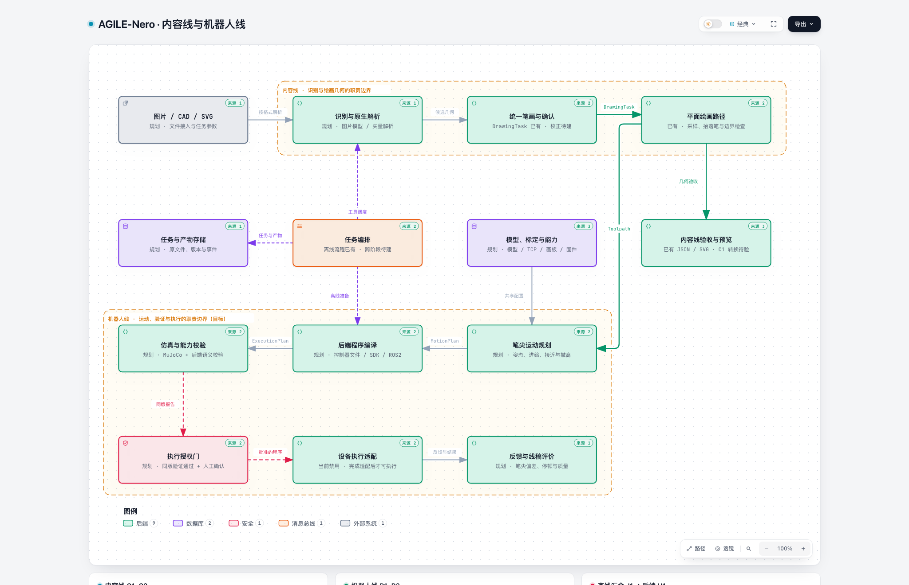

# 双线后端目标架构

架构分为内容线与机器人线。内容线交付确认的笔画和毫米平面路径；机器人线结合共享模型、标定和能力，生成特定后端的执行程序。该图是目标设计，节点直接标明已有、规划和禁用状态。

[交互架构图](backend.html) · [架构源文件](backend.architecture.json) · [生成与验证记录](backend.receipt.json)



## 先看边界与验收

- [双线契约](track-contracts.md)：每个阶段的输入、输出、责任、能力条件和验收关口，是本设计的权威说明。
- [共用样例](../../examples/acceptance/README.md)：两条直线、一段圆弧、两次笔画间抬笔；离散几何阈值与未来实机阈值分别定义。
- [样例离线证据](acceptance-evidence.json)：现有程序已验证 55 个路径点和约 0.048 mm 的合成几何弦偏差。
- [路线图](../roadmap.md)：C1–C2 与 R1–R3 分别推进，J1 离线汇合后才讨论单独授权的 H1。
- [模块导航](../modules.md)：按目录定位具体工作上下文。

## 关键设计

图片走识别与线条提取，CAD/SVG 优先解析原生几何，统一成 DrawingTask / Toolpath。MotionPlan 保留基座坐标下的笔尖运动意图；ExecutionPlan 才是控制器文件、SDK 运动段或关节轨迹等特定表示。

calibration、assets/robots/nero 和 robot/profiles 为规划、仿真与后端转换提供统一依据。三个候选后端放在 robot/backends 下，先验收一条路线；硬件绘画执行器目前仍固定拒绝调用。

MuJoCo 作为验证适配器，不代替运动规划。原生控制器语义未知时只提供名义预演证据。最终授权必须绑定具体程序、模型、标定、能力、场景与起始状态条件，并要求适配验收和人工确认。

workflow 调度受约束的工具，artifacts 管理产物。图中公共编排的连线是主要调用，不把它表示成高频控制器；当前 JSON 写入实际位于 api/cli，存储服务与跨阶段工作流仍待实现。

## 当前代码事实

- contracts/drawing.py：已有 DrawingTask / Toolpath，单位 mm、drawing_plane。
- planning/planar.py、planning/validation.py：已有平面采样、边界与抬落笔检查。
- workflow/offline.py、simulation/offline.py：固定流程只到几何预演，结果绑定 path_sha256。
- api/cli.py、artifacts/svg.py：已有 JSON / SVG 产物。
- robot/ports.py：UnadaptedRobotBackend 始终拒绝物理执行。

新增目录当前保存契约与验收说明，不伪装成已经实现的适配器。图内 source 链接固定到生成时的已提交证据版本，设计来源与代码来源均明确标注。

## 重新生成

使用 Archify 3.x，在仓库根目录调用 finalize，并提供 --repo-root。本轮原始 candidate、HTML 和质量记录按请求保存在 .archify 的独立子目录；发布副本与证据位置由 backend.receipt.json 记录。

```sh
node /Users/jiachenboo/.codex/skills/archify/bin/archify.mjs finalize architecture docs/architecture/backend.architecture.json outputs/architecture/two-tracks.html --repo-root . --quality showcase --json
```

复现需要本地 Git 中包含 source 指向的固定提交。发布 HTML 与原始产物逐字节一致，自动检查与截图审查分别记录；页面下方的验收卡片按正常文档流阅读。
